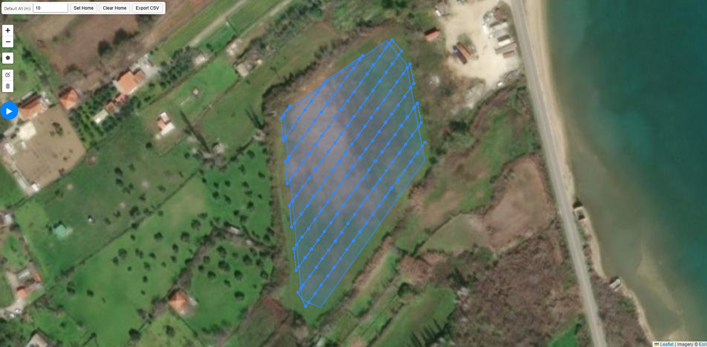

# UAV Survey Waypoint Generator

A web-based tool for planning UAV mapping surveys. The user draws a survey polygon on an interactive satellite map, optionally selects a home position, and the application generates an optimized sequence of survey waypoints.

## Part of an End-to-End UAV Mapping System

This repository contains the mission-planning component of a larger UAV mapping system developed as part of the SciDrones project.

The system is organized into two separate software components:

**1. [UAV Survey Waypoint Generator](https://github.com/nickefs/citizen-drone-survey-planner)**

A web-based mission planner that generates survey routes from user-defined geographic areas, taking into account camera geometry, image overlap, flight altitude, and route efficiency.

**2. [UAV Companion Computer](https://github.com/nickefs/citizen-drone-companion-computer)**

Raspberry Pi software responsible for converting survey waypoints into ArduPilot-compatible missions, communicating with the flight controller via MAVLink, managing camera triggering, and storing geotagged aerial images.

### End-to-End Workflow

1. Define a survey area on the interactive map.
2. Generate and optimize the survey waypoints.
3. Export the mission as a CSV file.
4. Import the mission into the Raspberry Pi companion-computer software.
5. Convert and upload the mission to the flight controller via MAVLink.
6. Execute the autonomous survey and capture geotagged aerial imagery.

## Preview



## Features

- Interactive satellite map using Leaflet and Leaflet Draw
- Polygon-based survey area definition
- Optional UAV home-position selection
- Configurable flight altitude
- Automatic survey-line spacing from camera geometry and image overlap
- Automatic camera-trigger spacing
- Automatic search for an efficient survey grid angle
- Home-aware selection of the survey entry corner
- Turnaround and interior trigger waypoints
- CSV waypoint export
- Docker-based deployment

## Architecture

```text
Browser / Leaflet
       |
       | polygon + altitude + optional home
       v
Node.js / Express API
       |
       | stdin / process arguments
       v
C++ Survey Generator
       |
       | JSON
       v
Generated Waypoints
       |
       v
Map visualization / CSV export
```

The frontend sends the polygon to `POST /api/survey`. The Node.js server launches the compiled C++ `survey_cli` program. The C++ engine calculates the survey geometry and returns the generated waypoints as JSON.

## Current Survey Configuration

The current C++ CLI uses the following camera configuration:

| Parameter | Value |
| --- | ---: |
| Front overlap | 25% |
| Side overlap | 25% |
| Sensor width | 3.68 mm |
| Sensor height | 2.76 mm |
| Focal length | 3.04 mm |
| Image width | 3280 px |
| Image height | 2474 px |
| Turnaround distance | 3 m |

Grid spacing and trigger distance are calculated automatically from the camera model, altitude and overlap.

The generator evaluates survey grid angles and selects the route with the lowest cost based on path length and a turn penalty.

## Project Structure

```text
citizen-drone/
├── cpp/
│   ├── nqt_helpers.hpp
│   ├── nqt_survey.cpp
│   ├── nqt_survey.hpp
│   └── survey_cli.cpp
├── public/
│   └── index.html
├── docs/
│   └── screenshots/
├── Dockerfile
├── package.json
├── server.js
├── .dockerignore
├── .gitignore
└── README.md
```

## Run with Docker

Build the image:

```bash
docker build -t citizen-drone .
```

Run the container:

```bash
docker run --rm -p 3000:3000 citizen-drone
```

Then open:

```text
http://localhost:3000
```

## Run Locally

Requirements:

- Node.js 20+
- npm
- A C++17-compatible compiler such as `g++`

Compile the C++ survey generator:

```bash
g++ -O2 -std=c++17 cpp/nqt_survey.cpp cpp/survey_cli.cpp -Icpp -o survey_cli
```

Install the Node.js dependencies:

```bash
npm install
```

Start the server:

```bash
npm start
```

Then open `http://localhost:3000`.

## API

### `GET /ping`

Simple health check.

Response:

```text
pong
```

### `POST /api/survey`

Example request body:

```json
{
  "polygon": [
    { "lat": 39.1010, "lon": 26.4395 },
    { "lat": 39.1015, "lon": 26.4405 },
    { "lat": 39.1008, "lon": 26.4410 }
  ],
  "altitude_m": 10,
  "home": {
    "lat": 39.1012,
    "lon": 26.4398
  }
}
```

The response contains an ordered `waypoints` array with latitude, longitude, altitude and waypoint type.

## Deployment

The application is containerized with Docker and can be deployed as a web service. The Docker build installs the Node.js dependencies, compiles the C++ survey engine, and starts the Express server.

## Future Improvements

- Make camera parameters configurable from the web interface
- Make overlap settings configurable
- Add mission-format export for common UAV autopilots
- Add automated tests for survey geometry
- Separate frontend JavaScript and CSS as the interface grows
